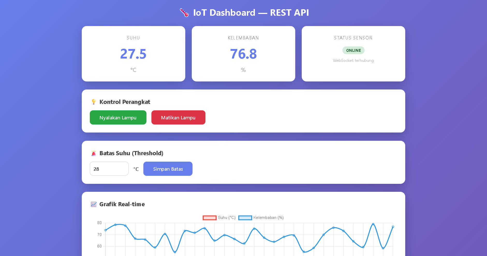
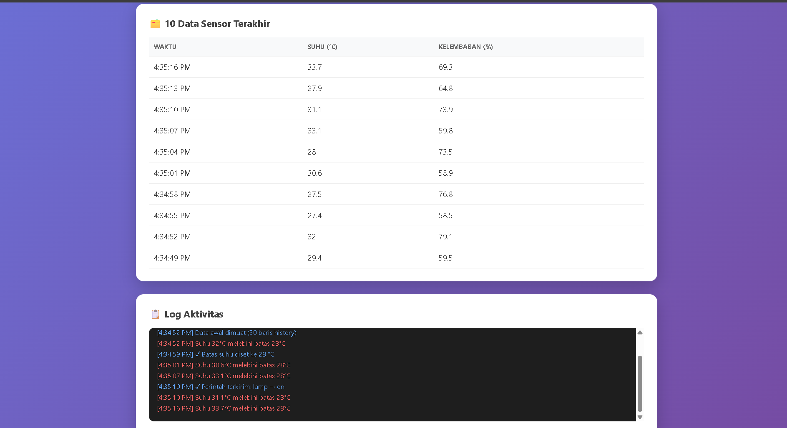
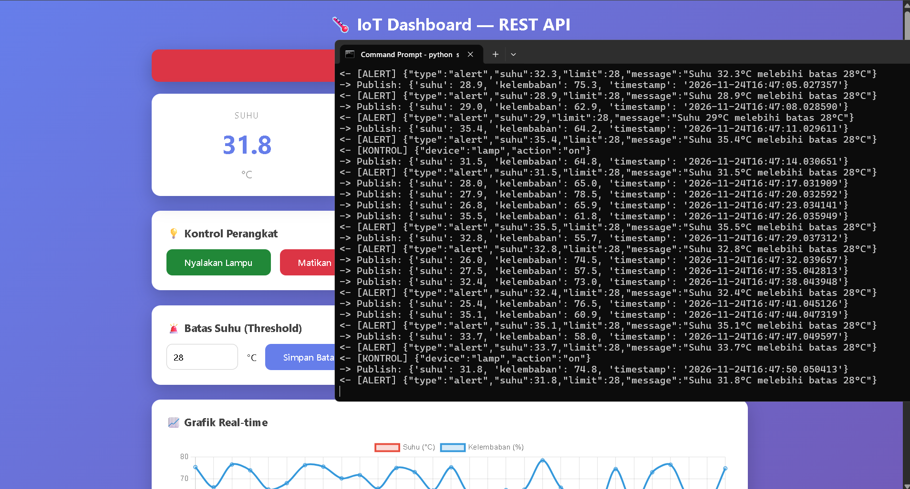
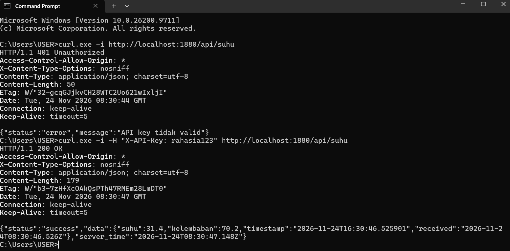
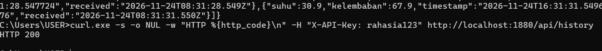
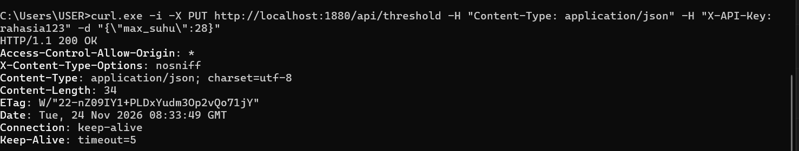
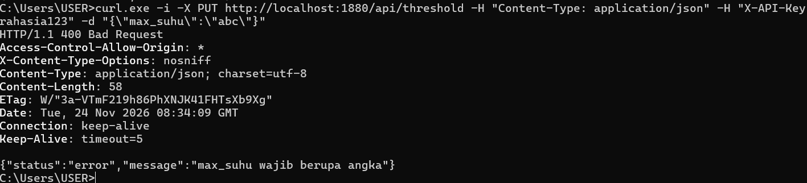
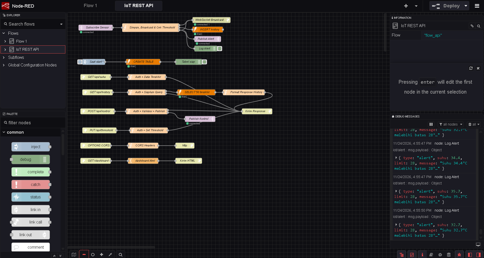

# Tugas Praktek 9 — REST API Node-RED (IoT)

Sistem monitoring & kontrol IoT: **Simulator ESP32 → MQTT → Node-RED (REST API + WebSocket + SQLite) → Web Dashboard**.

Mata kuliah Pemrograman Internet of Things (SIF1502) — UNISKA Banjarmasin.

Nama: **Andhika Zulfanie Rahman** | NIM: **2410020042**

## Arsitektur

```
simulasi_esp32.py --MQTT iot/sensor--> Mosquitto --> Node-RED
                                                      ├─ simpan ke SQLite (iot.db)
                                                      ├─ push via WebSocket /ws/sensor --> dashboard
                                                      ├─ cek threshold --> alert (WebSocket + MQTT iot/alert)
                                                      └─ REST API /api/*
```

## Endpoint (semua endpoint `/api/*` wajib header `X-API-Key`)

| Endpoint | Method | Fungsi |
|---|---|---|
| `/api/suhu` | GET | Data sensor terakhir |
| `/api/history` | GET | 50 data terakhir dari SQLite |
| `/api/kontrol` | POST | Kirim perintah ke perangkat via MQTT |
| `/api/threshold` | PUT | Set batas suhu (`{"max_suhu": 30}`) |
| `/ws/sensor` | WebSocket | Data real-time & alert |
| `/dashboard` | GET | Halaman dashboard |

## Tugas Pengembangan

| # | Tugas | Status | Implementasi |
|---|---|---|---|
| 1 | PUT `/api/threshold` + notifikasi | ✅ | Function "Auth + Set Threshold"; alert dibuat di "Simpan, Broadcast & Cek Threshold" lalu dikirim ke WebSocket (banner di dashboard) dan MQTT `iot/alert` |
| 2 | Grafik real-time Chart.js | ✅ | Canvas `#chart` di `dashboard.html` |
| 3 | API key `X-API-Key` | ✅ | Dicek di setiap function endpoint; salah/kosong = 401 |
| 4 | WebSocket tanpa polling | ✅ | `websocket out` path `/ws/sensor`; dashboard memakai `new WebSocket` |
| 5 | History ke SQLite | ✅ | Tabel `sensor_history`, INSERT prepared statement, GET history lewat SELECT |

## Cara menjalankan

1. Install Node.js LTS, lalu `npm install -g --unsafe-perm node-red`
2. Install Mosquitto dan pastikan broker berjalan di port 1883
3. `pip install paho-mqtt`
4. Jalankan `node-red`, buka http://localhost:1880, lalu install palette `node-red-node-sqlite`
5. Menu ☰ → Import → pilih `flows.json` → Deploy
6. `python simulasi_esp32.py`
7. Buka http://localhost:1880/dashboard

## Contoh uji dengan curl

Linux / macOS / Git Bash:

```bash
curl -H "X-API-Key: rahasia123" http://localhost:1880/api/suhu
curl http://localhost:1880/api/suhu                     # -> 401
curl -X PUT http://localhost:1880/api/threshold -H "Content-Type: application/json" -H "X-API-Key: rahasia123" -d '{"max_suhu":28}'
curl -X POST http://localhost:1880/api/kontrol -H "Content-Type: application/json" -H "X-API-Key: rahasia123" -d '{"device":"lamp","action":"on"}'
```

Windows Command Prompt (gunakan `curl.exe` dan escape tanda kutip):

```
curl.exe -i -X PUT http://localhost:1880/api/threshold -H "Content-Type: application/json" -H "X-API-Key: rahasia123" -d "{\"max_suhu\":28}"
```

## Keterbatasan

- API key ditulis di JavaScript frontend sehingga bisa dilihat pengguna; cocok untuk praktikum, bukan produksi (gunakan login/token + HTTPS).
- Threshold disimpan di memori Node-RED (kembali ke 30 °C setelah restart).
- Chart.js dimuat dari CDN sehingga butuh internet.

## Screenshot

### Dashboard



### Kontrol lampu dan alert (dashboard + simulator)


### Pengujian REST API





### Flow Node-RED

